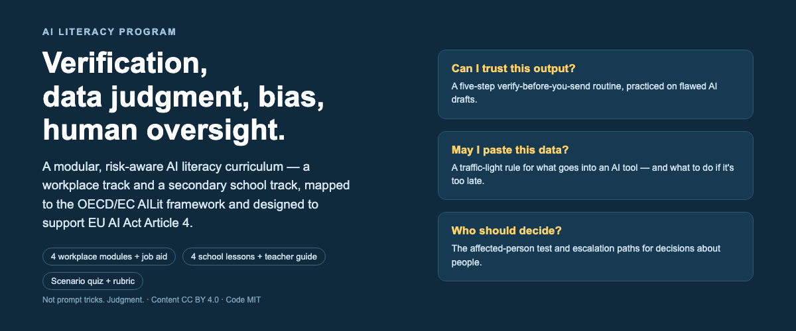

# AI Literacy Program

A modular, risk-aware **AI literacy curriculum** with a workplace track and a secondary school track — mapped to the OECD/EC AILit framework and designed to support EU AI Act Article 4. It teaches **verification, data judgment, bias awareness and human oversight**, not prompt tricks.

**[Live site](https://iwyusdaz.github.io/ai-literacy-program/)** · **[Design documentation](https://iwyusdaz.github.io/ai-literacy-program/design/)** · Role: Sole designer

**Evaluation status:** Automated accessibility testing and agent-based design reviews are complete. AI-simulated learner and review-panel evaluations are pending. No real learners have tested this yet. See evaluation/METHODS.md.

## The problem

Organizations that build or use AI in the EU must take measures to support staff AI literacy (Article 4 of the AI Act, applying since 2 February 2025, amended July 2026). Schools have the OECD/EC AILit framework (June 2026). Yet 75% of knowledge workers already use generative AI at work — mostly self-taught — and workplace AI training skews toward productivity rather than risk (see [secondary research](research/secondary-research.md) for sources). The typical "AI awareness course" doesn't change what people do at the moment of truth: *can I trust this output, may I paste this data, who decides?*

## Audience and context

- **Workplace track** — employees at a fictional logistics company ("Northwind Logistics", 1,200 staff, DE/NL) using AI for customer service, operations planning and HR administration. Four ~20-minute modules, B1 plain English, mobile-friendly, plus a one-page job aid.
- **School track** — students aged 14–16, taught by a **non-specialist** teacher: 4 × 50-minute lessons with an unplugged fallback, printable handouts, and a final project.

## My approach (analysis → design → build → evaluate)

1. **Framework study first:** the amended Article 4 text (consolidated 27 July 2026) and the final AILit framework were verified against primary sources before any content was written ([framework notes](research/framework-notes.md)).
2. **Needs analysis** grounded in cited secondary research: root causes sorted into knowledge/skill/motivation/environment, with non-training fixes flagged; five critical behaviors defined ([needs analysis](https://iwyusdaz.github.io/ai-literacy-program/design/needs-analysis.html)).
3. **Design:** observable objectives (condition–behavior–criterion), a full [alignment matrix](https://iwyusdaz.github.io/ai-literacy-program/design/alignment-matrix.html) (objective → content → practice → assessment → framework competence), and a 10-entry design-decisions log.
4. **Build:** vanilla HTML/CSS/JS for the interactive and quiz (no frameworks, no network calls); Jekyll + Just the Docs for content.
5. **Evaluate:** automated accessibility audit, scripted task tests, an agent review, and two pending API-key pipelines ([methods and limits](evaluation/METHODS.md)).

## Key design decisions

1. **Performance objectives, not "awareness"** — Article 4 is about literacy proportionate to context; awareness alone doesn't change behavior. Every objective is an observable decision (identify, classify, decide). *Evidence: amended Art. 4 text; needs analysis.*
2. **Scenario-based assessment with per-option feedback** — all 12 quiz items are workplace decisions, each distractor a plausible mistake with its own teaching feedback, results reported by objective. *Alternative considered: recall MCQs — rejected because the critical behaviors are decisions.*
3. **A job aid alongside the course** — verification is an infrequent, error-prone task; the one-page [Verify before you send](https://iwyusdaz.github.io/ai-literacy-program/workplace/job-aid-verify-before-you-send.html) checklist supports the moment of need. *Evidence: root cause "no verification routine exists".*
4. **2D interactive by default; 3D skipped** — the next-word interactive is keyboard-first vanilla JS with hard-coded probabilities; the optional three.js embedding-space experiment was skipped because the human comparison test that would justify it wasn't available ([rationale](DECISIONS.md)). *Evidence: presence-vs-learning research (Makransky et al.).*
5. **Same core concepts, two tracks** — prediction → verification → bias → oversight runs through both tracks with different scenarios; one alignment matrix, one rubric. *Evidence: portfolio goal + reuse economics.*

## Evidence and evaluation

**What was measured (done):** automated WCAG 2.1 A/AA audit (axe-core) — 0 critical/serious violations on every page; scripted task tests (Playwright) — 51/51 checks: keyboard-only flows, 320 CSS px reflow on every page of the site, step counts, live-region announcements.

**Pending (pipelines built and tested, awaiting API keys):** AI-simulated learner runs (20 runs across 5 personas × 2 knowledge levels × 2 models) with quiz item analysis, and a multi-model review panel (3 reviewer roles × ≥2 models, agreement reported). Run with one command: `npm run eval:pending`. Results tables stay empty ("PENDING: requires API key") until then.

**What this evidence can show:** the mechanics work (flows, accessibility rules, item structure); design documentation is complete and reviewable.

**What it cannot show:** learning gains, engagement, transfer, or "validated with users" — no real learners have tested this. AI-simulated runs *cannot* show learning even when run (personas may already know the content); they find item-quality and clarity problems. The Agent review is not educator or expert feedback, and may share the author's underlying model (stated limitation). No VoiceOver run has happened (script provided); no review by a daily assistive-technology user has happened. Full inventory: [evaluation/METHODS.md](evaluation/METHODS.md), report: [evaluation report](https://iwyusdaz.github.io/ai-literacy-program/design/evaluation-report.html).

## Accessibility

- Tested with axe-core 4.11.1 (WCAG 2.1 A/AA + best practice): **0 critical/serious violations on all pages**.
- Scripted keyboard tests pass for the interactive and the quiz (tab order, activation, slider arrows, live announcements); reflow verified at 320 CSS px (400% zoom at 1280) **on every page of the site** — the four workplace modules initially failed this check (rendered Mermaid code blocks and wide tables overflowed by 61–332 px) and were fixed with plain lists and scroll-in-place CSS; `prefers-reduced-motion` respected; correctness never color-alone (✓/✗ text icons); quiz is `fieldset`/`legend` per question with feedback in a live region.
- **Not done:** a manual VoiceOver pass (Guidepup automation doesn't work on macOS 27 — a [step-by-step manual check script](evaluation/human-protocol/manual-voiceover-check.md) with expected announcements is provided), and review by someone who uses assistive technology daily. Both are disclosed limitations, not claims.

## What I'd do differently / next steps

- Run the pending pipelines (they are fully built; only API keys are missing) and act on the item analysis.
- Commission the real 5–8-person pilot — every material for it is in `evaluation/human-protocol/`.
- Add an accessible tagged PDF of the job aid (v1.0 ships HTML/print as the primary format — documented decision).
- Localize the workplace track (the B1 English is a constraint, not a solution, for a DE/NL workforce).
- Extend AILit coverage where the [mapping](https://iwyusdaz.github.io/ai-literacy-program/design/framework-mapping.html) honestly shows gaps (energy consumption, choosing between AI approaches).

## Tools used

Jekyll + Just the Docs v0.12.0 (GitHub Pages), vanilla JS/CSS, Playwright 1.57.0 (tests), axe-core 4.11.1 (audits), Node.js pipelines for pending evaluations, gitleaks (secret scanning). Content and code written with AI assistance (disclosed below).

## License and attribution

- **Learning content** (text, personas, assessment items, rubrics, handouts): [CC BY 4.0](https://creativecommons.org/licenses/by/4.0/) — `LICENSE`.
- **Code** (interactive, quiz, page styles): [MIT](https://opensource.org/license/mit) — `LICENSE-CODE`.
- Third-party material: `ATTRIBUTION.md`. Fictional entities (Northwind Logistics, personas) are labeled fictional wherever they appear.

## AI-assistance disclosure

This curriculum was **drafted with AI assistance** (build agent, October 2026) and reviewed as follows: factual claims about the EU AI Act and the AILit framework were verified against primary sources with access dates (`research/sources.md`); automated accessibility and keyboard tests were run; a structured **Agent review** by a separate reviewer agent is complete (2026-10-26, `evaluation/agent-review.md`; labeled as agent review, never educator feedback — its findings are fixed in the same revision round; see `evaluation/METHODS.md` §4). Known limits: AI-drafted content can date quickly (each page carries a "Last reviewed" stamp) and no human expert or learner has reviewed it yet.
