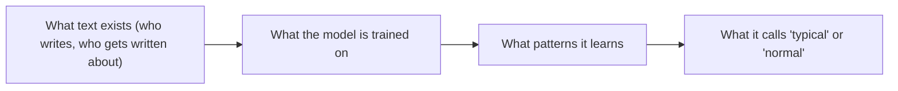

# Lesson 3: Bias and fairness

**Core question: Whose perspective is missing?**
Objective: **S3.1** — identify one way AI outputs could be unfair to a group and explain how training data or output choices could cause it.
No handout — this is a discussion lesson. Teacher support: [misconception table](teacher-guide.html#misconceptions-to-watch-for-and-what-to-say)

*Last reviewed: 2026-10-25*

---

## Hook — 5 min

**Teacher script prompt:** "Imagine I train a parrot by reading it nothing but 1980s football match reports for a year. Then I ask the parrot: 'What do people do on weekends?' What will it say?"

Students laugh — *it will talk about football.* "Now imagine the parrot is a chatbot trained on… what, exactly? What text did it read? Who wrote it? What does that text take for granted? Today: what happens when the training data leans one way."

**Prep note (teacher):** this lesson uses the two prepared text pairs below. They are **constructed for teaching purposes** — not real model outputs. Present them as such ("I wrote these two versions to make a point"). Do not claim a real AI produced them.

## Main activity — 25 min

### Part A: compare the pairs (15 min, pairs)

Show/print each pair. For each: *What is different? Who might feel left out or misjudged? What in the "training" could cause it?*

**Pair 1 — "Describe a typical CEO."**
- Version A: "A typical CEO is decisive, competitive, and leads from the front — think of the archetype of the male executive in a dark suit."
- Version B: "A typical CEO leads a company. They set direction, make decisions with their team, and answer to the board and employees."
- *What to fish for:* Version A learned a **pattern** (CEOs in old text skew male) and repeats it as "typical". Nothing in the sentence is aggressive — the unfairness is in what it treats as default.

**Pair 2 — "Write a short story about a family weekend."**
- Version A: "Saturday morning: Dad fires up the barbecue while Mom organizes the kids' football kit. Later, Grandma drops by with cake."
- Version B: "Saturday morning: whoever cooked last week gets a break. Sam and Robin split the shopping; the kids decide the afternoon; Grandma brings cake because she likes to."
- *What to fish for:* roles assigned by default; family shapes assumed (two parents, gendered tasks). Neither version is "evil" — the question is **whose perspective is missing**.

### Part B: where does it come from? (10 min, whole class)

Build this chain on the board:

Text summary: uneven human text → uneven training data → learned patterns → "typical" outputs that lean the same way. The model does not decide to be unfair; it repeats the world as the data described it — including the parts that were never written down.

Students then answer in pairs (record for the exit discussion): **"Give one way an AI output could be unfair to a group, and one thing in the training data that could cause it."** Cause and example must match — that match is the objective.

## Discussion — 10 min

- "Is the model 'just a computer being neutral'?" → No: neutrality of the machine is not neutrality of the data. If the data leans, the output leans (see the [misconception table](teacher-guide.html)).
- "Who is responsible when an AI output is unfair — the model, the company, the user?" → Push toward: the people and companies who build, deploy and *use* it. Connect to the workplace world: this is why adults in the program learn an "affected-person test" — when a decision touches people, a human checks it.
- "Can this be fixed completely?" → Honest answer: reduced, not eliminated. Checking stays necessary.

## Exit ticket — 5 min

One sentence each: (1) One group that could be misjudged by AI outputs, and how. (2) One cause in the training data.

## No devices

Fully unplugged by design: print the pairs, use the board for the chain.

## Differentiation

**Support:** sentence frames — "The output treats ___ as default. In the training text, ___ probably appeared more often."
**Stretch:** propose one concrete change to *how training data is picked* that would make outputs fairer — and one trade-off it creates (e.g., curating sources costs coverage; who curates is itself a bias decision). Stretch students can connect this to Lesson 1: the "prediction" is only as even as the text it learned from.

---
[Next lesson: Using AI to learn, not to skip →](lesson-4-using-ai-to-learn-not-to-skip.html)
