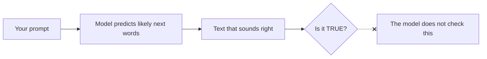

# Module 1: What AI is (and isn't)

**Core question: Where is AI already in my work?**
Time: ~20 minutes · Reading level: B1 · [Next module: Checking outputs →](module-2-checking-outputs.html)

*Last reviewed: 2026-10-25*

---

## 1. Start with a scenario

**Lena, customer service agent at Northwind Logistics** (fictional), opens the AI assistant:

> **Customer:** "My order NW-88123 has not arrived. I ordered 10 days ago and the website said 3 days."
>
> Lena types: *"Write a friendly reply. It should calm the customer down and explain the delay."*
>
> The AI answers in seconds: *"Dear Ms. Weber, I am very sorry. Your order NW-88123 is on its way and will arrive within 48 hours."*

Lena feels relief. The reply sounds perfect. But wait — **how did the AI know the order would arrive within 48 hours?**

It didn't. It *predicted* words that usually follow words like "delay" and "sorry". The "48 hours" may be copied from some other text — or simply likely-sounding. Nobody checked it.

This module explains what actually happened. The next modules teach you what to do about it.

## 2. Concept: prediction, not lookup

A generative AI assistant does one central thing: **it predicts the next word** (and then the next, and the next), based on patterns in the huge amount of text it was trained on.

Text summary: your prompt goes in; the model predicts likely words; the output sounds right; **whether it is true is not checked by the model** — that check is yours.

This explains three things people often get wrong:

| Common belief | What is actually happening |
|---|---|
| "It looked it up in our database." | It **predicted** plausible text. It has no live access to Northwind's systems unless a tool is explicitly connected. |
| "It sounds confident, so it's probably right." | Fluency and truth are **separate**. Fluent wrong text is the normal failure mode, not the exception. |
| "It knows our company rules." | It knows **patterns from public text**. Northwind's rules, prices and SLAs are not in its head. |

Two quick words you will see again: **narrow AI** does one task (a spam filter); **generative AI** produces new text, images or code. The assistant is generative. Both fail differently — this program is about the generative one.

## 3. Worked example

Back to Lena. Her supervisor asks: "Did the AI make that up?"

A correct explanation in two sentences:

> "The AI predicted a likely reply. 'Within 48 hours' is a plausible-sounding promise, not a checked fact from our order system. I need to check the real delivery date before we send this."

Notice what the explanation does: it separates **what sounds right** from **what is verified**. That separation is the whole program.

## 4. Practice: sort the tasks

For each task at Northwind, decide: **good fit**, **risky fit**, or **poor fit** for generative AI? Then open the answer and compare.

**Task A.** Draft a polite reply to a complaint about a late delivery.

Answer — Task A

<strong>Good fit.</strong> Drafting text is what generative AI does best. You check names, dates and promises before sending (Module 2).

**Task B.** Calculate the exact delivery cost for a 40 kg pallet to Rotterdam.

Answer — Task B

<strong>Poor fit.</strong> Language models are bad at exact arithmetic and have no access to the current tariff table. Use the pricing tool. If you ask the AI, verify every number against the source (Module 2).

**Task C.** Summarize a 20-page weekly operations report for the team.

Answer — Task C

<strong>Risky fit, usable with checks.</strong> Summarizing is a strong use case — but numbers in AI summaries can be invented or changed. Check every figure against the original (Module 2, "AI and numbers").

**Task D.** Decide which of three job applicants gets an interview.

Answer — Task D

<strong>Poor fit.</strong> A decision that affects people must stay with a human (Module 4). AI ranking also risks unfair bias against groups.

**Task E.** Rewrite an internal announcement in simpler English.

Answer — Task E

<strong>Good fit.</strong> Rewriting and simplifying text is a strong use case. Check that the meaning stayed the same.

**Task F.** Predict next month's delivery volume.

Answer — Task F

<strong>Poor fit (with a general assistant).</strong> Forecasting needs real historical data and a proper tool. A chatbot will produce a confident-sounding guess.

**Task G.** Explain the return policy to a customer, using the official policy text you paste in.

Answer — Task G

<strong>Risky fit, usable with checks.</strong> The AI may still mix in wrong details. Check every statement against the official text. Also: only paste policy text, never customer data (Module 3).

**Task H.** Choose which driver gets a warning after repeated delays.

Answer — Task H

<strong>Poor fit.</strong> Discipline affects a person's job. A human decides; AI must not rank or judge people (Module 4).

**Pattern to remember:** good fit = text work with human checks. Poor fit = exact numbers, decisions about people, anything needing live data. Risky = in between, with mandatory checks.

## 5. Reflect (1 minute)

Think of one task you did this week with AI. Was it a good fit? What did you check before using the output?

## 6. Check yourself

1. A colleague says: "The assistant gave me the answer, so it must have looked it up in our systems." What do you say?
2. Why is a fluent, confident answer not evidence that it is correct?
3. Name one task type that should not go near a general AI assistant at Northwind.

Show answers

<ol>
<li>It predicts likely text; it has no access to Northwind's systems unless a tool is explicitly connected.</li>
<li>Fluency (how the text sounds) and truth (whether it matches reality) are separate. The model predicts plausible words and does not check facts.</li>
<li>Any of: exact calculations, decisions about people (hiring, discipline), forecasting, anything needing live company data.</li>
</ol>

---

**Where next:** [Module 2 — Checking outputs](module-2-checking-outputs.html) teaches the five-step check that catches the "48 hours" problem every time.
